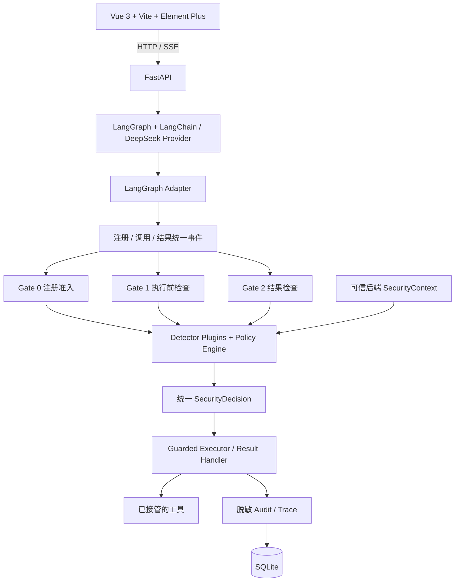

# AgentGuard 架构（P0 设计基线）

状态：本文描述目标架构；当前 P1 交付独立的无 Guard 基线，SDK 仍只有 P0 包骨架。
没有运行时 Guard。

## P1 当前可运行路径

`FastAPI → ChatService（内存会话）→ LangGraph StateGraph → LangChain BaseChatModel`
（默认 Fake，可选自定义 DeepSeek HTTP Provider）`→ 工具自身沙箱 → 模型回复`。
API 和演示依赖只在 `apps/api` 独立包/requirements-demo.lock 中声明，演示不 import SDK。
这条路径没有 Adapter/Gate/Guarded Executor；后续 P6 才接入 SDK。无 Guard 基线默认关闭，
仅显式启用时建立会话服务；真实 API 另需开关和密钥，具备基础调用/token 上限。
SSE 逐节点发送会话、工具调用、工具结果和最终消息；不声称逐 token 输出或审计。
SQLite 会话持久化尚未实现，前端仍是 P0 空应用。

## 分层与技术选型

这是逻辑依赖图，不表示每次调用都经过 Gate 0。真实生命周期约定如下：

1. Adapter 标准化工具注册/更新，Gate 0 判定后才进入受控工具集合。
2. 每次调用先生成 ToolCallEvent，Gate 1 根据可信上下文、Schema、权限、预算和审批判定。
3. Guarded Executor 仅在本次有效 ALLOW 下执行；BLOCK、未批准 REVIEW 和关键检查异常
   均不执行真实工具。审批完成后须重新验证调用、预算和工具版本，不能复用过期决策。
4. 工具正常或异常输出都生成 ToolResultEvent；Gate 2 处理后，Adapter 才返回安全结果给 LLM。
   BLOCK 不返回原始正文，SANITIZE 必须明确提供替换内容。
5. 审计关联 trace_id / tool_call_id；默认保存脱敏证据引用，避免保存不必要敏感原文。

Gate 2 无法撤销工具已经产生的副作用。保护范围仅为经过 Adapter 和 Guarded Executor
实际接管的调用路径；框架内置/托管或持有原始工具引用的绕过路径不在声明范围。

## 依赖方向

- SDK：Python 3.11+、Pydantic v2；不依赖 API、Web、演示 Agent 或 Benchmark。
- `contracts/core/gates/detectors/policies/executor/audit` 只依赖标准库、SDK 或其必要通用依赖。
- `adapters` 可在后续阶段使用显式可选依赖；Core 不反向导入 Adapter 或 LangGraph。
- 演示 Agent 通过公共 SDK 契约/Adapter 接入，不读取 Guard 内部实现。保留默认关闭、
  隔离运行的无 Guard 基线用于受控实验。
- API 使用 FastAPI、SSE 和 SQLite；Web 审计显示开关只控制展示，不影响后端 Guard。
- Benchmark 位于独立目录，其依赖、下载数据和运行环境不污染 SDK 安装。

## 职责与信任

Detector 只报告证据；Policy Engine 决定动作；Executor/Result Handler 强制落实。
可信身份、任务授权、资源范围与预算来自后端，模型输出不能提升权限。风险低分不能覆盖
硬性权限拒绝。关键上下文缺失、策略异常、未注册工具默认拒绝。
工具描述和结果始终是低信任数据，即使通过检测也不升级成系统指令。

## 阶段边界

P1 基线与 Provider；P2 Pydantic 契约与接口；P3 Gate 1/Executor；P4 Gate 2；
P5 Gate 0；P6 LangGraph 闭环；P7 UI/审计；P8 四项评测；P9 异构接入和工程加固。
P0 的模块只有说明性 docstring，没有 Gate、授权、策略、工具调用或网络逻辑。
SDK 默认依赖元数据、源文件静态导入和安装包隔离导入由 P0 测试覆盖；未来动态导入、
第三方插件与实际执行安全须在相应阶段扩展检查，不能用 P0 检查替代。

